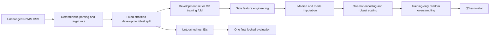

# Questions 1 through 2.4

## 1.1 Problem and classification task

South African communities experience unequal access to reliable municipal water services. The affected population includes households and the schools, clinics and small businesses that depend on municipal supply, especially in low-reliability Water Services Authorities (WSAs). Municipal water-service planners and the Department of Water and Sanitation (DWS) are the intended decision-makers. The system supports prioritisation of investigation and service-improvement resources; it does not automatically allocate resources or diagnose infrastructure failures.

The unit of prediction is one WSA in the supplied NIWIS extract. Predictors are aggregate population, water-access, and urban/rural composition measures available independently of the reliability outcome. `Class 1 (low reliability)` means that fewer than 60% of the WSA population has reliable supply. `Class 0 (reliable)` means 60% or more. The threshold was fixed before model fitting and matches the team's Q2.3 answer.

The export filename is dated 26 September 2026; this does not establish the underlying measurement period. The prediction horizon is the conditions represented by this cross-sectional extract, not the next month. Without earlier predictors and later interruption outcomes, the project must not claim to forecast future failures.

## 1.2 Success measures and error costs

The primary technical metric is macro-F1 because it gives the reliable and low-reliability classes equal weight despite the 105-to-39 class imbalance. Accuracy, vulnerable-class precision and vulnerable-class recall remain supporting metrics for later model evaluation.

The service-delivery indicator is high-need coverage under a declared review budget: the proportion of independently confirmed low-reliability WSAs included in the stakeholder's priority review list when only a fixed number or percentage can be investigated. This must be measured against later human verification; model accuracy alone does not prove improved water delivery.

A false positive diverts scarce assessment or planning capacity to a WSA that is not in the low-reliability class. A false negative can leave a genuinely low-reliability WSA out of the priority list, delaying investigation and potentially worsening inequitable service outcomes. Because both costs matter, macro-F1 is primary while vulnerable-class recall is reported separately.

## 1.3 Data governance, ethics and limitations

The WSA extract comes from the DWS National Integrated Water Information System (NIWIS) Water Supply Reliability dashboard. NIWIS states that the underlying Water Services Knowledge System data draws on Statistics South Africa censuses and General Household Surveys, aligned and updated through DWS Macro Planning. The official source describes a reliable service as one not interrupted for more than 48 consecutive hours and available for at least 350 days per year.

The official NIWIS information page is <https://www.dws.gov.za/niwis2/Info/WaterSupplyReliabilityInfo>. DWS retains copyright. The data is supplied free of charge for academic, research or personal use, may not be sold, carries no warranty of accuracy or completeness, and must acknowledge DWS. This is more restrictive and more accurate than the teammate draft's unverified `CC BY` statement.

The supplied area-level extract covers 144 distinct WSAs. It contains population, access and reliable-supply totals and percentages for overall, urban and rural populations. It does not contain interruption event histories, pipeline age, asset maintenance, rainfall, household-level records or a timestamp per observation. Results are ecological area-level estimates and cannot be interpreted as household predictions or causal explanations.

The data is aggregated and contains no direct personal identifiers, which substantially limits POPIA risk. Safeguards are to retain only necessary aggregate columns, avoid joining personal records, keep source files under their stated terms, and never expose detailed infrastructure vulnerability locations. Fairness checks should compare errors and representation by defensible geographic or rural/urban groups when those groups are available. Socio-economic variables must not be used to deprioritise disadvantaged communities. Predictions are advisory estimates, not definitive municipal rankings; a human planner must review source quality, uncertainty and local context before acting.

## 2.1 Data dictionary and audit

| Column | Meaning | Modelling role |
| --- | --- | --- |
| WSA Name | Water Services Authority name | Identifier; excluded |
| Population | Total WSA population | Candidate predictor |
| Population with access to water | Population with water access | Candidate predictor |
| Population Reliable Supply | Population with reliable supply | Target-derived leakage; excluded |
| % Population Reliable Supply | Overall reliable-supply percentage | Target source; excluded |
| Urban Population | Urban population | Candidate predictor |
| Urban Population with access to water | Urban population with water access | Candidate predictor |
| Urban Population Reliable Supply | Urban population with reliable supply | Target-derived leakage; excluded |
| % Urban Population Reliable Supply | Urban reliable-supply percentage | Target-derived leakage; excluded |
| Rural Population | Rural population | Candidate predictor |
| Rural Population with access to water | Rural population with water access | Candidate predictor |
| Rural Population Reliable Supply | Rural population with reliable supply | Target-derived leakage; excluded |
| % Rural Population Reliable Supply | Rural reliable-supply percentage | Target-derived leakage; excluded |
| low_reliability | 1 when overall reliable supply is below 60%, otherwise 0 | Target |

The executable audit parses space-separated counts and percentage strings, removes the empty export-index column, and preserves missing values for fold-local imputation. It reports class balance, exact and WSA-name duplicates, missingness, negative and impossible values, percentage ranges and count/percentage consistency. It also records IQR outliers as review flags rather than deleting them automatically. All overall, urban and rural reliable-supply counts and percentages are declared leakage and excluded from predictors.

The verified extract contains 144 rows and 144 distinct WSA names, with no exact duplicate rows or duplicate WSA identifiers. The target has 105 reliable WSAs (72.9%) and 39 low-reliability WSAs (27.1%). There are 45 missing cells: 9 in overall population with access, 7 in each rural measure, and 2 in each urban measure. The audit found no negative counts, percentages outside 0-100, or count/percentage mismatches beyond the 0.5 percentage-point rounding tolerance. It did flag 57 cases where an access or reliable-supply component exceeds its related population total, affecting 22 WSAs. These need source clarification and are not silently corrected.

The IQR procedure produced 109 column-level flags across 32 WSAs. Population-size outliers are plausible and remain in the data; the overall reliability outlier is Khai-Ma at 0%. IQR status alone is not a reason to delete a valid municipality.

The separate July 2026 national table is a control total, not nine training observations. Eight of its nine controls reconcile exactly to the WSA sums. Overall population with access does not reconcile: the WSA sum is 52,435,580 versus the national value of 52,988,091, a shortfall of 552,511 alongside nine missing WSA values. The workflow preserves and reports this difference rather than filling the missing source totals from the national aggregate.

## 2.2 Purposeful visualisations

Running the workflow creates five figures under `reports/q2/figures/`:

1. Binary target distribution, with WSA counts and the 60% class definition.
2. Missing observations by variable, in percent.
3. Population water-access rate versus reliable-supply percentage, with units, threshold and Pearson correlation.
4. Rural population share versus reliable-supply percentage, with units, threshold and Pearson correlation.
5. Mean reliable supply for overall, urban and rural population measures.

The workflow writes numerical interpretations to `reports/q2/interpretations.md`. Correlations and group means are descriptive associations, not evidence of causation.

## 2.3 Split and validation design

The workflow creates the binary target using the pre-declared policy threshold, then makes one fixed, stratified 80/20 holdout split with seed 42. On the supplied 144-row extract this produces 115 development WSAs and 29 test WSAs, retaining approximately the same 27.1% low-reliability rate. The test IDs are saved before any learned transformation and remain reserved for the final Q3-Q4 evaluation.

Model selection will use 5-fold stratified cross-validation repeated 5 times on the development set only. This uses the limited sample more efficiently than a single small validation set. The extract has no observation date, so a time split is impossible and future forecasting is out of scope. Each WSA occurs once, so the same WSA cannot cross the development/test boundary.

The original 144-row order can reconstruct nine province blocks for a grouped sensitivity analysis on the development set. That mapping is brittle, is not a predictor, and is valid only for the unchanged export order. The main split remains stratified because some provinces contain no low-reliability cases and grouped validation folds have very small positive counts.

## 2.4 Reproducible preparation pipeline

The deterministic cleaning stage standardises column names, parses counts and percentages, removes the empty export column and constructs the target. It does not fill missing values or learn statistics.

The feature engineer selects only population and access columns. It adds total, urban and rural access rates; urban and rural population shares; and a derived urban/rural/balanced category. The category is mode-imputed and one-hot encoded. Numeric features are median-imputed with missingness indicators and scaled with `RobustScaler`, which is less sensitive to extreme population values than mean/variance scaling.

`RandomOverSampler(random_state=42)` is the declared imbalance treatment. It is transparent and, unlike synthetic interpolation, does not create fractional or extrapolated combinations of municipal counts in this small dataset. It is the final preparation step and must be followed by the Q3 estimator in the same imbalanced-learn pipeline. Cross-validation then applies oversampling only to each training fold; validation and test rows retain their natural class distribution. The WSA identifier and every reliable-supply column are structurally unavailable to the feature transformer, preventing accidental leakage even if the raw frame contains them.

## Assumptions recorded

- The 60% threshold is a team decision, not an official NIWIS performance category.
- The source extract order is unchanged when province sensitivity groups are reconstructed.
- Missing predictors are missing information, not zeros.
- IQR outliers remain valid observations unless source verification proves an error.
- Question 2.4 prepares data only; model selection and evaluation begin in Question 3.
